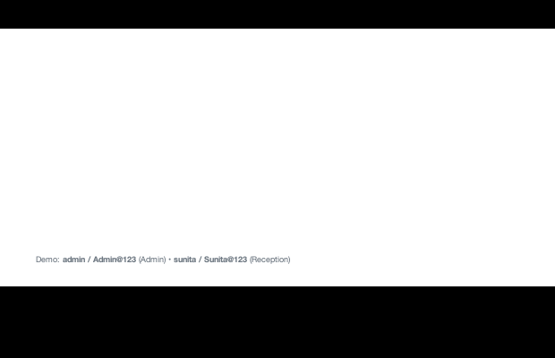
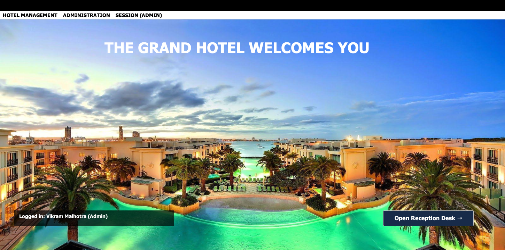
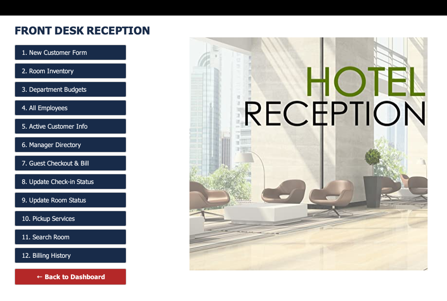
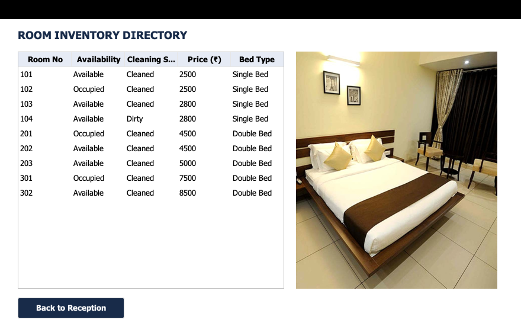
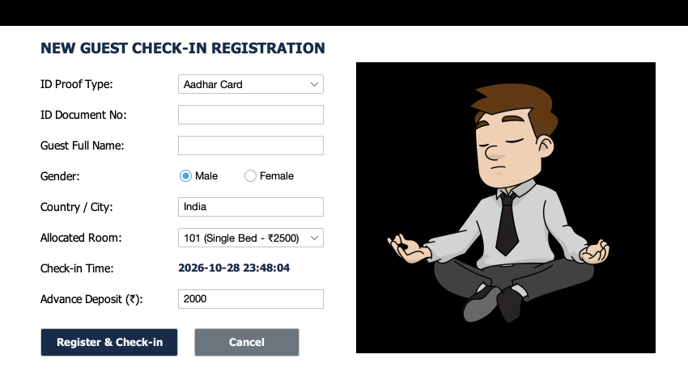
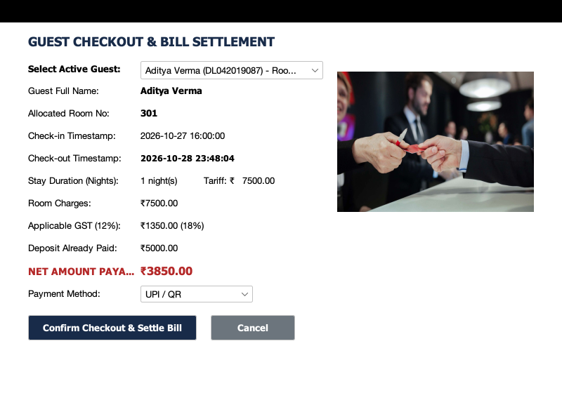
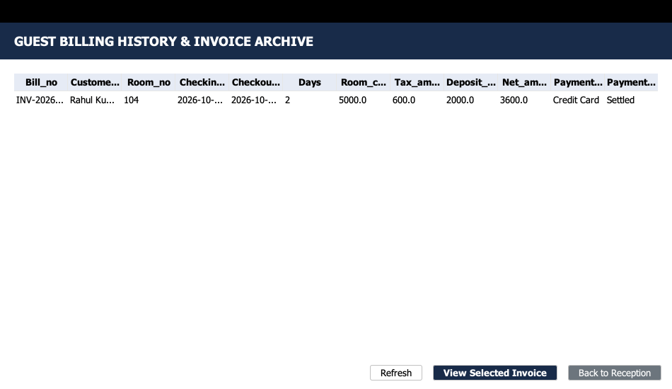

# 🏨 Hotel Management System

A reliable, full-featured desktop Hotel Management & Reservation System built in **Java Swing** with **FlatLaf Modern UI**, supporting zero-configuration **SQLite** on macOS and optional **MySQL** connectivity.


---

## 🌟 Key Features

- **Staff Authentication & Role-Based Access Control**:
  - Salted SHA-256 cryptographic password hashing.
  - Distinct roles: **Admin** (Staff, Room & Fleet Management) and **Receptionist** (Guest Check-in, Room Inventory, Checkout & Billing).
- **Guest Registration & Check-in**:
  - Comprehensive guest profile capturing ID proof (Aadhar Card, Passport, Driving License, Voter ID), contact details, and advance deposits.
  - Atomic database transactions reserving the room and updating occupancy in real-time.
- **Room Inventory & Housekeeping Management**:
  - Live inventory tracking across Single and Double bed configurations.
  - Multi-state room tracking: `Available`, `Occupied`, `Under Maintenance`.
  - Housekeeping status lifecycle: `Cleaned`, `Dirty`, `Cleaning In Progress`.
  - Room search and filter by bed type and availability.
- **Automated Billing, Tax & Checkout Engine**:
  - Calculates stay duration (nights) based on check-in and check-out timestamps.
  - Computes room gross charges and applies Indian Goods and Services Tax (GST 12% standard, 18% luxury suites).
  - Automatically deducts initial advance deposit and calculates net amount payable.
  - Preserves guest history in an audit-ready `billing_history` ledger instead of destructive deletion.
  - Auto-releases room back to inventory and marks it `Dirty` for housekeeping.
  - Displays and formats printable tax invoices (`INV-YYYYMMDD-XXXX`).
- **Staff, Department & Transport Fleet Management**:
  - Employee directory with salary, department, contact, and Aadhar records.
  - Department operational budget tracker.
  - Chauffeur and vehicle dispatch service for airport and railway station pickups.
- **Dual Database Architecture**:
  - **Zero-Setup Embedded SQLite** on macOS (auto-creates database and seeds demo data on launch).
  - Optional **MySQL** support via environment variables or configuration.

---

## 📸 Screenshots Gallery

| 01. Splash Screen | 02. Staff Login |
| :---: | :---: |
|  |  |

| 03. Executive Dashboard | 04. Front Desk Reception |
| :---: | :---: |
|  |  |

| 05. Room Inventory Directory | 06. Guest Check-in Form |
| :---: | :---: |
|  |  |

| 07. Checkout & Settlement | 08. Invoices & Billing Archive |
| :---: | :---: |
|  |  |

---

## 🔑 Demo Credentials & Profiles

The application automatically seeds realistic Indian demo profiles upon first launch:

### Staff Logins
| Username | Password | Role | Assigned Staff Member |
| :--- | :--- | :--- | :--- |
| `admin` | `Admin@123` | **Admin** | Vikram Malhotra (General Manager) |
| `sunita` | `Sunita@123` | **Receptionist** | Sunita Rao (Front Desk Clerk) |
| `reception` | `12345` | **Receptionist** | Front Desk Staff |

### Pre-Loaded Active In-House Guests
- **Aman Sharma** — Passport `P8972341`, Room `102` (Single Bed, ₹2,500/night), Deposit: ₹2,000
- **Priya Singh** — Aadhar `782345619012`, Room `201` (Double Bed, ₹4,500/night), Deposit: ₹4,000
- **Aditya Verma** — Driving License `DL042019087`, Room `301` (Double Bed Suite, ₹7,500/night), Deposit: ₹5,000

### Past Settled Guests
- **Rahul Kumar** — Room `104`, Settled Invoice `INV-2026-001`, Total: ₹5,600 (Paid via Credit Card)

---

## 🚀 Running on macOS

### Prerequisites
1. **Java Development Kit (JDK 17 or higher)**:
   ```bash
   # Check your Java installation
   java -version
   ```
   *(If not installed, run: `brew install openjdk`)*

2. **Apache Maven**:
   ```bash
   mvn -version
   ```
   *(If not installed, run: `brew install maven`)*

### Quick Start (Single Command)

Clone the repository and run the application directly:

```bash
# 1. Navigate to the project directory
cd "/Users/priyanshu/Desktop/Projects/Hotel Management"

# 2. Build and launch the application
mvn clean compile
mvn exec:java
```

### Alternatively: Run Standalone Packaged JAR
You can package a self-contained, all-in-one runnable JAR containing all dependencies and assets:

```bash
mvn package -DskipTests
java -jar target/hotel-management-system-1.0.0.jar
```

---

## 🗄️ Database Configuration

### Option A: SQLite (Default — Zero Setup)
No database installation or configuration is required. The system automatically creates a local SQLite database file `hotel_management.db` in the project root with complete schema and seed data.

### Option B: MySQL (Optional)
To connect to an external or local MySQL instance instead of SQLite, pass system properties or environment variables:

```bash
# Run with MySQL configuration
mvn exec:java -Ddb.type=mysql -Ddb.url="jdbc:mysql://localhost:3306/hotelmanagementsystem" -Ddb.user="root" -Ddb.password="your_password"
```

---

## 🧪 Automated Testing

The project includes an automated test suite verifying database initialization, salted password cryptography, input validation, tax computation, and room state transitions:

```bash
mvn test
```

### Test Coverage Highlights:
- `SecurityUtilsTest`: Verifies SHA-256 salted hashing, unique random salts, and legacy plaintext compatibility.
- `ValidationUtilsTest`: Validates Indian mobile numbers (+91 / 10 digits), emails, 12-digit Aadhar, and positive numeric values.
- `DatabaseManagerTest`: Verifies table creation, primary keys, and demo data integrity.
- `BillingAndRoomServiceTest`: Validates 12% and 18% GST tax tiers, stay duration calculations, deposit deductions, and room status lifecycles (`Available` → `Occupied` → `Dirty` → `Cleaned`).

---

## 🛡️ Security & Architecture Best Practices

- **Zero SQL Injection**: 100% of database interactions use parameterized `PreparedStatement` queries.
- **Cryptographic Security**: Passwords hashed with salt via `SHA-256` (`SecurityUtils`).
- **Atomic Operations**: Critical multi-step workflows (such as Check-in and Checkout) execute within transactional blocks (`setAutoCommit(false)`, `commit()`, `rollback()`).
- **Thread Safety**: Splash screen animations use non-blocking `javax.swing.Timer` instead of raw thread sleep loops.
- **UI Ergonomics**: Fully responsive layout with `JScrollPane` on all data tables, native column headers, and modern FlatLaf styling.

---

## 📄 License
This project is licensed under the MIT License.
